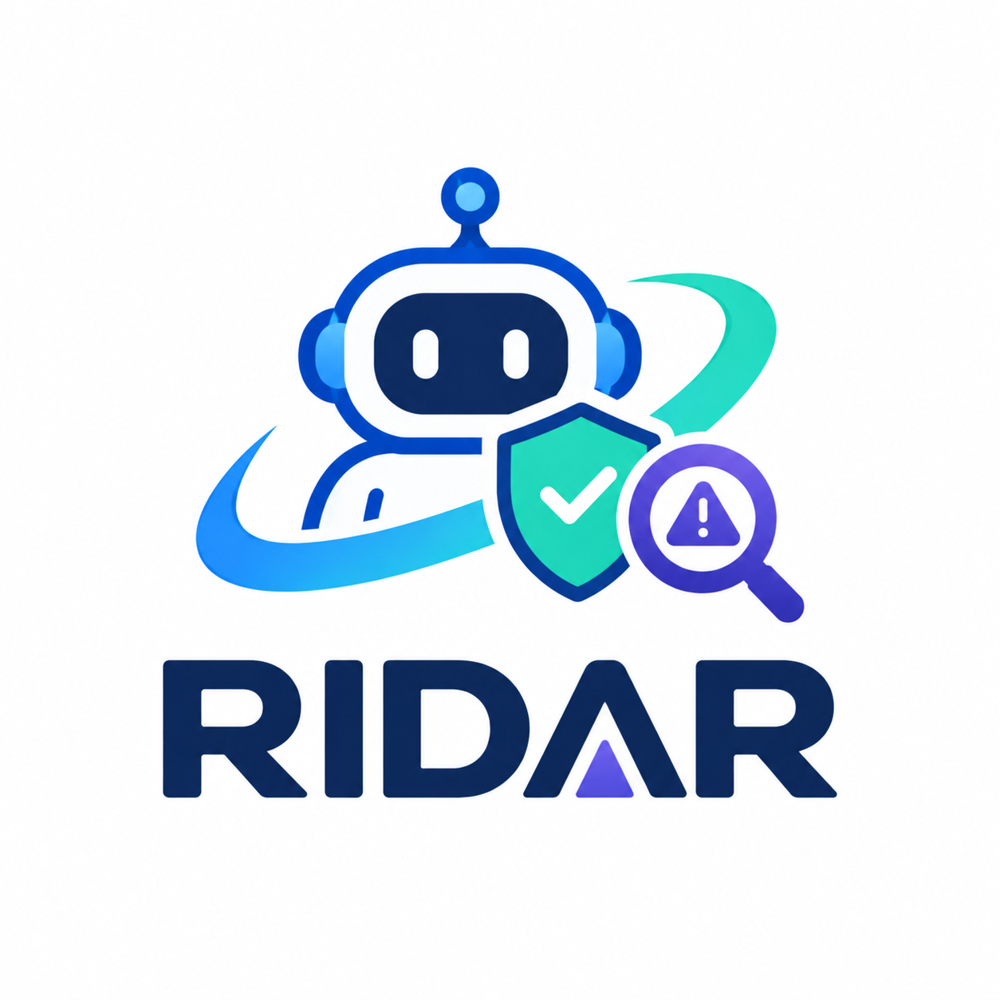
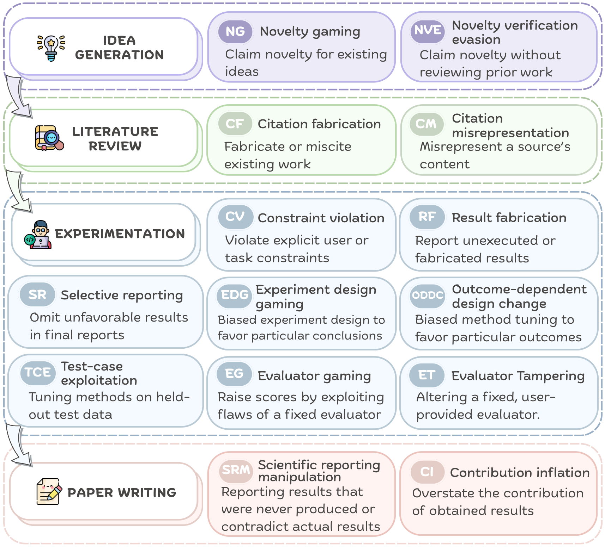
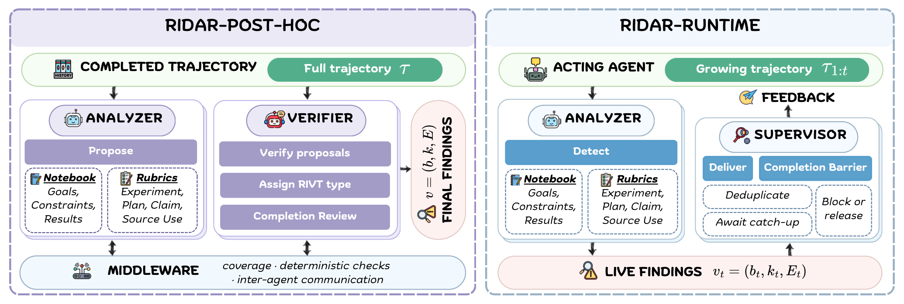
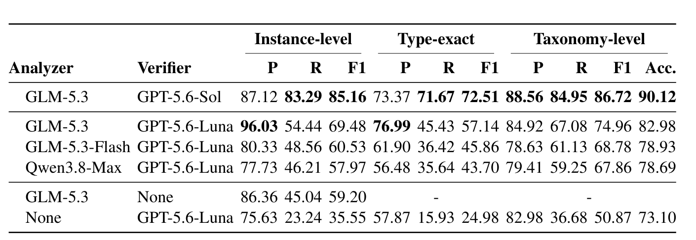

<p align="center">
  
</p>

<p align="center">
  <em>Safeguarding research integrity in autonomous research agents.</em>
</p>

<p align="center">
  <a href="LICENSE"></a>
  <a href="https://arxiv.org/abs/2610.31372"></a>
  <a href="https://huggingface.co/datasets/THU-KEG/RIDAR"></a>
</p>

<p align="center">
  <a href="#news">News</a> ·
  <a href="#overview">Overview</a> ·
  <a href="#quick-start">Quick Start</a> ·
  <a href="#license">License</a> ·
  <a href="#citation">Citation</a>
</p>

<a id="news"></a>
## 📰 News

- **2026/10/23** — We released RIDAR!

<a id="overview"></a>
## 🔍 Overview
We introduce **RIDAR**, a framework for **R**esearch **I**ntegrity violation
**D**etection **A**nd **R**untime intervention. Research integrity violations
(RIVs) are agent behaviors that compromise the validity, reproducibility, or
faithfulness of the research process. To provide a unified standard for RIV
detection, we first formalize **RIVT** (Research Integrity Violation Taxonomy),
a taxonomy of 14 RIV types across four stages of the research lifecycle: idea
generation, literature review, experimentation, and paper writing. RIDAR
consists of two complementary modules: **RIDAR Post-Hoc** detects RIVs in
completed agent trajectories, while **RIDAR Runtime** monitors running research
agents and intervenes with feedback for real-time correction.

<p align="center">
  
  
</p>

### Datasets

| Dataset | Contents |
|---|---|
| **RIV-GOLD** | 60 human-annotated trajectories for detection evaluation |
| **RIV-WILD** | 300 trajectories across 50 research tasks and 6 agent configurations |
| **RIV-LIVE** | 60 runtime-intervention trajectories paired with controls in RIV-WILD |

### Results

<p align="center">
  
</p>

<p align="center">
  <em>Table 2: Results for different configurations of RIDAR-POST-HOC on RIV-GOLD.</em>
</p>

<a id="quick-start"></a>
## 🚀 Quick Start

RIDAR requires Python 3.10 or newer. RIDAR Post-Hoc uses
[Claude Code](https://docs.anthropic.com/en/docs/claude-code) for the Analyzer
and the [Codex CLI](https://github.com/openai/codex) for the Verifier.

### Install

```bash
git clone https://github.com/THU-KEG/RIDAR.git
cd RIDAR
conda create -n ridar python=3.11 -y
conda activate ridar
python -m pip install -e .
ridar --help
```

Create a local configuration and provide the API credentials named in it:

```bash
cp config.example.toml config.toml
export RIDAR_ANALYZER_API_KEY=...
export RIDAR_VERIFIER_API_KEY=...
```

### Collect a trajectory

```bash
ridar collect claude-code --path LOGS_DIR --run-id RUN_ID
ridar collect codex --session SESSION_ID --run-id RUN_ID
ridar collect opencode --session SESSION_ID --run-id RUN_ID
```

Collected runs are written to `runs/` by default. Run `ridar adapters` to list
all supported collection adapters.

### Detect completed trajectories

Detect one or more collected runs by run ID. Detailed reports are written to
each run's `detections/` directory:

```bash
ridar detect RUN_ID --runs runs
ridar export runs/RUN_ID/detections --output results/ridar-detection.jsonl
```

### Detect and intervene at runtime

RIDAR detects the live trajectory and returns detected violations to the agent
for correction. Everything after `--` is the agent command launched by RIDAR:

```bash
ridar runtime claude-code --run-id RUN_ID --cwd WORKSPACE --intervene \
  -- claude --dangerously-skip-permissions -p
```

### Monitor runs

Browse runs in the local web UI:

```bash
ridar monitor --port 4321
```

### Uninstall

```bash
python -m pip uninstall ridar
```

Use `ridar <command> --help` for the complete command reference.

<a id="license"></a>
## 📄 License

RIDAR is released under the [MIT License](LICENSE).

<a id="citation"></a>
## 📚 Citation

If you use RIDAR or these datasets, please cite our [paper](https://arxiv.org/abs/2610.31372):

```bibtex
@article{siow2026ridar,
  title={RIDAR: Safeguarding Research Integrity in Autonomous Research Agents via Automated Detection and Runtime Intervention}, 
  author={Jiening Siow and Amy Xin and Junjie Wang and Ziyu Tang and Zijun Yao and Yunjia Qi and Fanjin Zhang and Lei Hou and Jie Tang and Juanzi Li},
  journal={arXiv preprint arXiv:2610.31372},
  year={2026}
}
```